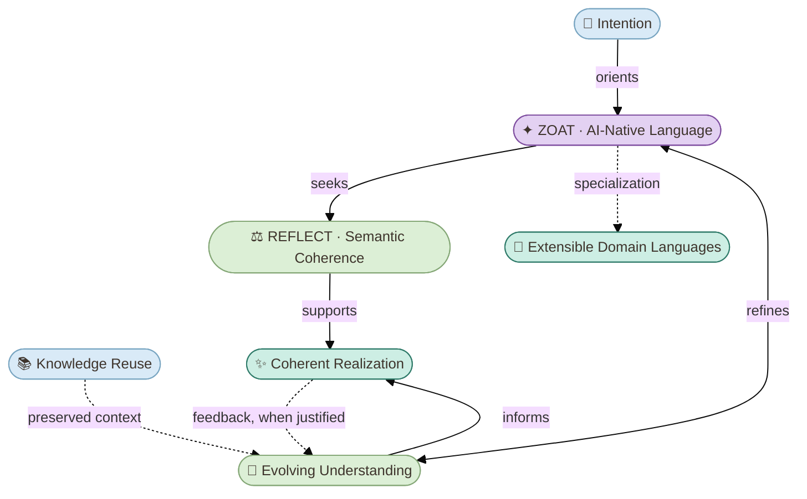
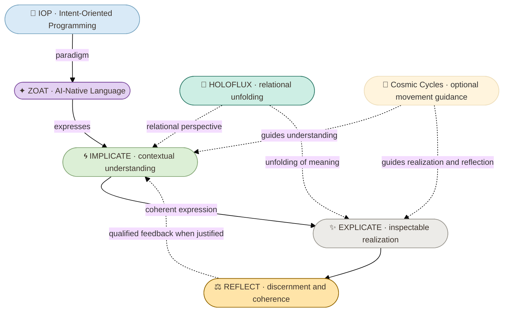

# Project ZOAT

**AI-Native Language for Intent-Oriented Programming (IOP)**

> **Intention · Evolving Understanding · Coherent Realization**

ZOAT is an **experimental, LLM-native semantic language** for Intent-Oriented Programming (IOP). It explores how intentions, context, evolving understanding, and domain-specific knowledge can be expressed in coherent, inspectable forms.

**Vision:** AI-native engineering driven by intention, evolving understanding, domain-specific knowledge, interactive refinement, and coherent realization.

This is the **public-facing project**. It presents concepts, aspirations and selected capabilities without disclosing implementation details or presenting unverified language/runtime features as shipped functionality.

## Contents

- [Overview](#overview)
- [Concepts Map](#concepts-map)
- [Key Characteristics](#key-characteristics)
- [Conceptual Architecture](#conceptual-architecture)
- [Relationship to HOLOFLUX](#relationship-to-holoflux)
- [Scope and Status](#scope-and-status)
- [References](#references)

## Overview

ZOAT places **intention at the center** of a semantic approach to AI-native work. Understanding can evolve as evidence, context, and questions change. Coherent realization seeks to preserve meaningful relationships between what is intended, what is understood, and what is expressed.

The project explores a reusable semantic foundation across different subject areas; its public presentation emphasizes outcomes and interpretability rather than execution internals.

## Visual labels

The diagram symbols below are **editorial choices used in this public README**, not a verified official mapping supplied by `zoat-lang`. A canonical visual vocabulary has not been established by the currently inspected skill material. Their labels and conceptual meanings remain authoritative regardless of the pictograms shown.

## Concepts Map

The diagram describes **conceptual relationships**, not a parser pipeline, autonomous agent architecture, or completed runtime.

## Key Characteristics

| Characteristic | Public meaning |
| --- | --- |
| **Intention** | Purpose guides inquiry, expression, and relevant actions. |
| **Evolving Understanding** | Meaning can be refined as context, evidence, and perspectives change. |
| **Interactive Refinement** | Dialogue supports contextual exploration and improvement. |
| **Semantic Coherence** | Intended meaning and its expression should remain aligned. |
| **Knowledge Reuse** | Qualified understanding may be reused with its context and limits. |
| **Extensible Domain Languages** | The semantic approach can be specialized for different knowledge domains. |
| **Coherent Realization** | Understanding can inform explanations, artifacts, and other inspectable outcomes. |

These are **design characteristics and research directions**, not a claim that all corresponding mechanisms are implemented and validated.

## Conceptual Architecture

## Relationship to HOLOFLUX

**ZOAT** is the proposed semantic language for IOP. **HOLOFLUX** offers a complementary conceptual perspective on how meaning relates and unfolds between implicit understanding and explicit expression. **Cosmic Cycles** provides reusable, optional guidance for movements of understanding, realization, and reflection; it is not another mandatory stage, a storage model, or a replacement for HOLOFLUX.

The relationships are conceptual. No diagram should be interpreted as proof of a running interpreter, automatic persistence, guaranteed verification, or a mandatory processing lifecycle.

## Scope and Status

- **Public scope:** vision, concepts, distinctions, accessible explanations, and original presentation material.
- **Experimental status:** semantic language proposals and research; maturity varies by capability.
- **Not claimed:** production-ready runtime, universally executable syntax, automatic skill loading, verified long-term memory, or autonomous orchestration.
- **Disclosure boundary:** technical experiments, private implementation notes, and unpublished specifications are not reproduced here.

## Visual Identity

The ZOAT presentation uses the **HOLOFLUX-inspired visual language** of luminous, interrelated flows. The selected cover artwork is `infograph-zoat.webp`. Once the binary asset is successfully committed at `images/infograph-zoat.webp`, add its verified link as the README cover. The image currently contains the older footer URL `github.com/enogrob/zoat`; the public repository address is `github.com/enogrob/project-zoat`. Do not publish a broken cover link or mistake an obsolete QR code for a working project link.

## References

- [Project HOLOFLUX — public conceptual foundation](https://github.com/enogrob/project-holoflux)
- [ZOAT public repository](https://github.com/enogrob/project-zoat)
- [Cosmic Cycles — reusable semantic guidance](https://github.com/enogrob/project-skills/tree/main/skills/zoat-cosmic-cycles)

---

**Zoatworks — Turning Complexity into Understanding**

_Public conceptual overview; not a statement of implementation completeness._
